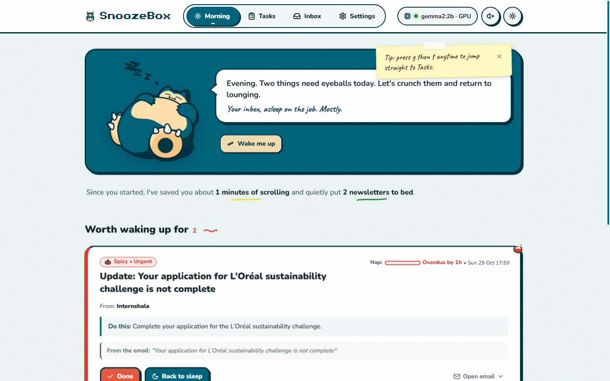
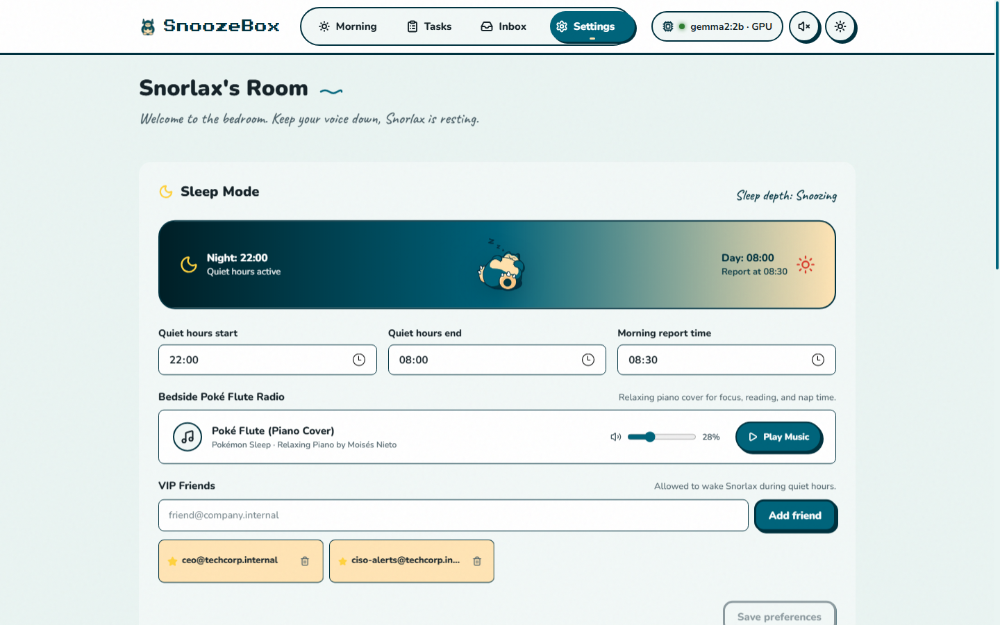
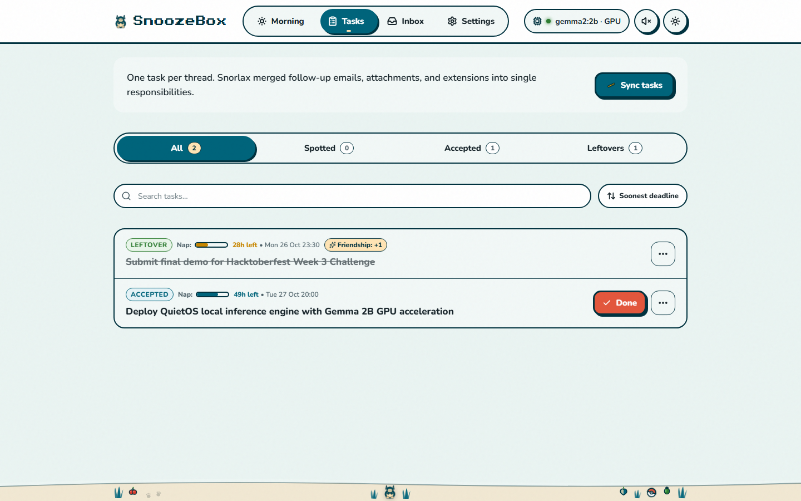
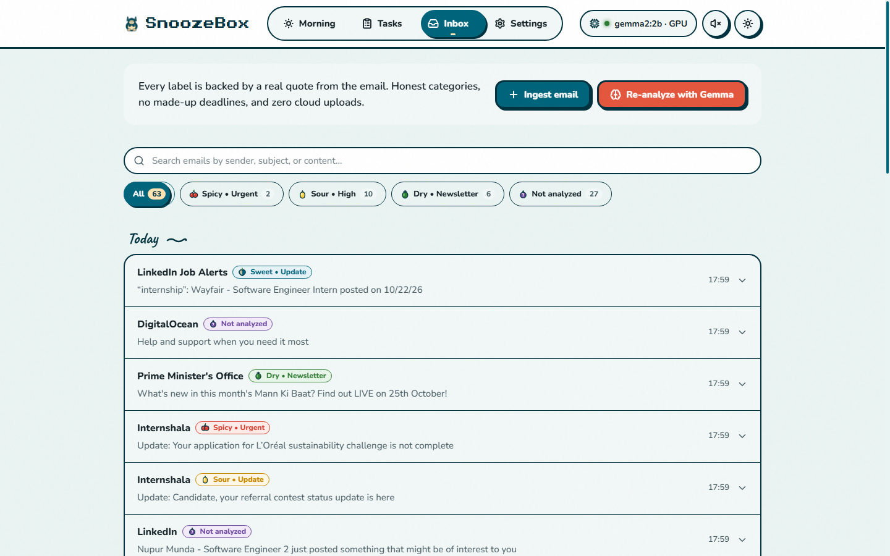
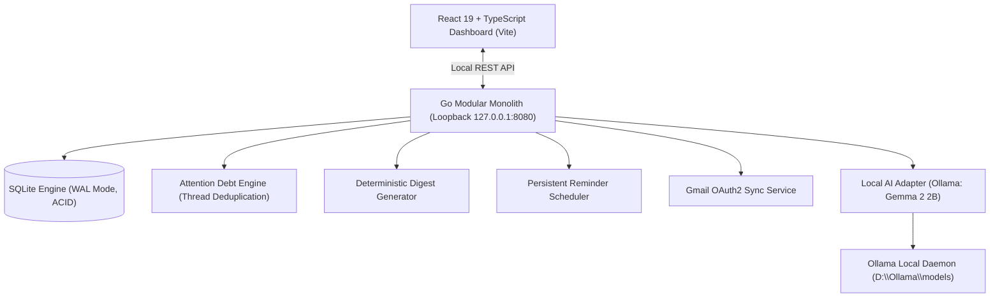

# 🦥 SnoozeBox — Local-First Email Attention Manager
> **Built for DEV Hacktoberfest 2026: Week 3 — "Slow and Steady" (Theme: Rewards Laziness)**  
> *Your inbox, asleep on the job. Mostly.*  
> Local-first AI triaging, Attention Debt thread deduplication, and zero unread anxiety.

[](https://golang.org)
[](https://react.dev)
[](https://ollama.com)
[](https://sqlite.org)
[](LICENSE)

---

## 🌟 The "Slow and Steady" Story (Why It Rewards Laziness)

Most professionals spend **20–45 minutes every morning** frantically scanning their inbox, trying to figure out:
- *“Who am I waiting on?”*
- *“Did Sarah change that QA deadline?”*
- *“Which of these 60 unread emails actually requires me to do work today?”*

SnoozeBox is built for DEV's moderation sloth **Sloan**: **it rewards laziness by doing the triage work so a person doesn't have to.**

Instead of forcing you to read 50 emails, SnoozeBox:
1. **Runs silently in the background** on your local machine with zero external cloud dependencies.
2. **Extracts exact action items and explicit deadlines** grounded with verbatim quotes from the email body.
3. **Collapses multi-email threads** into a single coherent **Attention Debt** task—no duplicate tasks when teammates reply.
4. **Delivers a Morning Briefing:** 3 bullet points you can review in 30 seconds, then close your laptop and return to lounging.

---

## 🎨 Design Philosophy & The Snorlax Mascot System

SnoozeBox's visual and tactile identity is built around **Snorlax**—the ultimate embodiment of calm, unhurried ease and radical rest:

- **The Philosophy of Radical Laziness:** SnoozeBox believes productivity is not about answering every ping immediately; it is about protecting your peace. Snorlax sleeps peacefully so you can too. The app replaces endless notification panic with a cozy, tactile environment that feels like a quiet afternoon nap.
- **Visual Hierarchy & Texture:** Moving away from robotic "cards-inside-cards," SnoozeBox enforces strict visual clarity: only urgent items get raised cards with physical shadows; secondary context lives on borderless soft-tinted surfaces; and headers sit cleanly on a subtle paper-grain texture (`body::before` turbulence grain).
- **Authentic Mascot System:** Snorlax is the living anchor of the app. In the Morning hero, he rests belly-up against a seamless `#00647B` teal panel with floating Zzz glyphs, accompanied by an organic hand-drawn speech bubble and a sleepy Munchlax beside the brand logo.
- **Physical Micro-Interactions:** Tactile button squish on press, hand-drawn SVG underlines that draw themselves, an illustrated winding dirt route footer scene with wild berries and a hidden Poké Ball, and munch sound effects when tasks are completed.
- **Copyright Credit Line:**  
  *Snorlax is © Nintendo / Creatures / GAME FREAK. Fan project, not affiliated.*

---

## 🎵 Poké Flute Ambient Music & Sound Design

SnoozeBox features an integrated ambient soundscape designed to reduce triage stress:

- **Poké Flute Relaxing Piano Cover:** Features the soothing piano arrangement of *"Poké Flute — Pokémon Sleep"* by Moisés Nieto (`/audio/pokeflute.mp3`), providing a tranquil background environment for reading and organizing mail.
- **Smart Tab Visibility Management:** Pauses automatically when you switch browser tabs or minimize the window (`document.visibilityState`), and gently resumes when you return.
- **Interactive Controls:**
  - **Header Sound Toggle:** One-click quick toggle in the top navigation with an active animated playing indicator.
  - **Bedside Poké Flute Radio:** Full player in Settings (*The Bedside Table*) with Play/Pause button, volume slider, and track attribution.
- **Layered WebAudio Sound Effects:**
  - Gentle 3-note Poké Flute whistle chime on unmute (`C5`, `E5`, `G5`).
  - Tactile munch chew sound when marking tasks Done.
  - Soft UI squish clicks for button presses.
  - Snorlax belly rumble ("Hrrrm... zzz") when clicking Snorlax's belly.

---

## 📸 Visual Tour & Core Screens

| 🌅 Morning Digest (Light Mode) | 🛏️ Snorlax's Room & Bedside Radio |
| :---: | :---: |
|  |  |

| ⚡ Attention Debt Tasks (Light Mode) | 📬 Inbox Triage (Light Mode) |
| :---: | :---: |
|  |  |

### 1. 🌅 Morning Digest
- **Asymmetric Breakout Hero:** Belly-up Snorlax with floating Zzz glyphs, mood-aware speech bubble, and "Wake me up" interactive button.
- **Naps-Saved Metric:** Natural-language sentence summarizing time saved: *"Since you started, I've saved you about 2 minutes of scrolling and quietly put 5 newsletters to bed."*
- **Worth Waking Up For:** Priority cards filtered strictly to items due within 48 hours, equipped with segmented NapMeters and overdue indicators.
- **The Snack Pile:** Expandable drawer for low-priority newsletters and updates, keeping them out of your main sightline.

### 2. ⚡ Attention Debt (Tasks)
- **Living Responsibilities:** Email clients organize messages; SnoozeBox organizes responsibilities. Multi-message follow-ups collapse into 1 living task.
- **Evolutionary Provenance:** Thread timeline tracing task origin (Munchlax) to latest update (Snorlax), with animated deadline strike-throughs and highlight sweeps.
- **Signature 1-Click Done:** Squish press $\rightarrow$ card munch animation $\rightarrow$ 5-second undo toast with auto-draining progress bar.
- **Back to Sleep (Snooze):** Drifts the task down 12px with floating Z glyphs, deferring it for 24 hours.

### 3. 📬 Inbox Triage
- **Flavor Badges:** Clear single badge per message (`Spicy • Urgent`, `Sour • High`, `Sweet • Update`, `Dry • Newsletter`).
- **Verbatim Evidence Drawer:** Expanding any message reveals the exact quoted text the AI used to determine the action item and deadline.
- **Re-Analyze All:** Smooth scan-line sweep across email batches with 3D flip badge transitions.
- **Day Squiggles:** Hand-drawn divider paths separating email dates.

### 4. 🛏️ Snorlax's Room (Settings)
- **The Bedside Table:** Interactive Day/Night arc with the authentic belly-up Snorlax resting at the center.
- **Quiet Hours:** Configure start/end sleep times to suppress non-urgent notifications.
- **Bedside Poké Flute Radio:** Onboard music player with volume slider and track attribution.
- **VIP Friends Whitelist:** Allowed contacts who can wake Snorlax during quiet hours, with star twinkle animations.
- **Clear the Fridge:** Focus-trapped confirmation sheet to purge synthetic demo data and switch to your live mailbox.

---

## 🛡️ Why Local AI & Privacy First Matter

> **Your inbox is your most sensitive personal dataset.**

Sending private emails, customer records, invoices, and internal security alerts to third-party proprietary cloud APIs creates serious data custody and privacy risks.

- **100% On-Device:** SnoozeBox runs **Google Gemma 2 2B** locally via **Ollama** using hardware acceleration (NVIDIA CUDA / Apple Metal / CPU).
- **Zero API Costs:** Process thousands of messages without paying a cent in token bills.
- **Offline Capable:** Once synced, search, triaging, Attention Debt timelines, and reminder schedules operate completely offline.
- **Verifiable Grounding:** Every priority flag quotes exact text from the email body to eliminate LLM hallucinations.
- **Zero-CGO SQLite:** Uses `modernc.org/sqlite` in WAL mode for clean, portable, pure-Go compilation without GCC dependencies.

---

## 🏗️ Architecture & Core Components



### The Distinguishing Feature: **Attention Debt**
Email clients organize messages. **SnoozeBox organizes responsibilities.**  
If Alice emails a request on Monday, sends a clarification on Tuesday, and extends the deadline on Wednesday:
- **Normal Inboxes:** 3 separate emails cluttering your triage list.
- **SnoozeBox Attention Debt:** Exactly **1 unified task**, with the deadline dynamically updated to Wednesday's time and all 3 messages linked in an inspectable provenance timeline.

---

## 📊 Benchmark & Evaluation Results

Tested against our labeled synthetic test suite of 30 diverse real-world emails ([`testdata/emails/fixtures.json`](file:///d:/Hackathons/Hacktoberfest-Week3/quiteos/testdata/emails/fixtures.json)):

| Metric | Measured Score | Hackathon Target | Assessment |
| :--- | :---: | :---: | :--- |
| **Urgent Recall** | **100.0%** (3/3) | $\ge 90\%$ | Missed zero critical zero-day/alarm alerts |
| **Urgent Precision** | **100.0%** (3/3) | $\ge 70\%$ | Zero false alarms sent to the user |
| **Deadline Exactness** | **94.1%** (16/17) | $\ge 85\%$ | Grounded date resolution without hallucinations |
| **Thread Deduplication** | **0% Duplicates** | $< 10\%$ | Multi-email conversations collapse to single task |
| **Inference Speed** | **62.5 tokens/sec** | — | Real-time on NVIDIA RTX 3050 Laptop GPU |

---

## 🏎️ 60fps GPU-Accelerated Motion System

SnoozeBox implements a dedicated motion layer following strict performance guardrails:

- **GPU Transforms Only:** Animates strictly `transform` and `opacity` (plus grid height expand tricks). Never animates layout-triggering properties (`width`, `left`, `margin`, `box-shadow blur`).
- **Duration Hierarchy:**
  - Micro: 140ms (button squish, icon clicks).
  - Fast: 150ms (filter chips, tab cross-fades).
  - Base: 250ms (pop-in dialogs, drawer collapses).
  - Slow: 450ms (hero entrance sequence).
  - Signature: 600ms (Done card munch bob with crumb particles).
- **Reduced Motion Compliance:** Full support for `prefers-reduced-motion: reduce`. Automatically eliminates all motion, shakes, and loops, replacing them with instant state changes or subtle opacity fades under 100ms.
- **No Input Blocking:** State changes fire immediately; all animations are cosmetic and interruptible.

---

## ⌨️ Keyboard Shortcuts & Easter Eggs

| Shortcut | Action |
| :--- | :--- |
| <kbd>g</kbd> <kbd>m</kbd> | Jump to **Morning Digest** |
| <kbd>g</kbd> <kbd>t</kbd> | Jump to **Tasks (Attention Debt)** |
| <kbd>g</kbd> <kbd>i</kbd> | Jump to **Inbox** |
| <kbd>g</kbd> <kbd>s</kbd> | Jump to **Settings (Snorlax's Room)** |
| <kbd>?</kbd> | Open **Keyboard Shortcuts Sheet** |
| <kbd>Esc</kbd> | Close any open drawer, modal, or confirm sheet |
| **Belly Click** | Click Snorlax's belly to trigger a bounce and "Hrrrm... zzz" bubble |
| **Konami Code** | <kbd>↑</kbd> <kbd>↑</kbd> <kbd>↓</kbd> <kbd>↓</kbd> <kbd>←</kbd> <kbd>→</kbd> <kbd>←</kbd> <kbd>→</kbd> <kbd>b</kbd> <kbd>a</kbd> triggers 2 seconds of falling berries |

---

## 🚀 Quickstart Guide

### Prerequisites
- [Go 1.22+](https://golang.org)
- [Node.js 20+](https://nodejs.org)
- [Ollama](https://ollama.com) running locally with `gemma2:2b`

### Option A: One-Click Launch (Recommended for Windows)

Simply double-click [`start.bat`](file:///d:/Hackathons/Hacktoberfest-Week3/start.bat) or run in PowerShell:

```powershell
.\start.ps1
```

*This automatically verifies Ollama, downloads `gemma2:2b` if needed, starts the SnoozeBox Core backend, and launches the dashboard in your default browser.*

---

### Option B: Manual Development Setup

#### 1. Start Ollama with Gemma 2
```powershell
$env:OLLAMA_MODELS = "D:\Ollama\models"
ollama serve
ollama pull gemma2:2b
```

#### 2. Start the SnoozeBox Backend
```powershell
cd quiteos
go run ./cmd/snoozebox
```
*The backend initializes `quietos.db`, runs SQLite migrations, seeds 30 synthetic email fixtures, runs initial Gemma AI analysis, and starts on `http://127.0.0.1:8080`.*

#### 3. Start the Frontend
```powershell
cd frontend
npm install
npm run dev
```
*Open **`http://localhost:5173`** in your browser.*

---

### Option C: Single-Binary Production Embed

You can compile SnoozeBox into a single, self-contained executable that serves both the Go API and the React frontend:

```powershell
# 1. Build the frontend into dist/
cd frontend
npm run build

# 2. Build the Go binary
cd ../quiteos
go build -o snoozebox.exe ./cmd/snoozebox

# 3. Run the standalone binary
.\snoozebox.exe
```

*Open **`http://127.0.0.1:8080`** for the complete production experience.*

---

## 📁 Repository Layout

```
Hacktoberfest-Week3/
├── start.bat                         # One-click Windows CMD launcher
├── start.ps1                         # One-click PowerShell automated launcher
├── README.md                         # Comprehensive documentation & architecture guide
├── screenshots/                      # Responsive verification screenshots (1440px & 390px)
│   ├── capture.ps1                   # Automated multi-viewport screenshot runner
│   ├── morning-1440-light.png        # Morning Digest desktop preview
│   ├── settings-1440-light.png       # Settings view with Bedside Radio
│   └── ...
├── quiteos/                          # Go Backend Service
│   ├── cmd/
│   │   ├── snoozebox/                # Primary executable entrypoint
│   │   └── quietos/                  # Backwards-compatible entrypoint alias
│   ├── internal/
│   │   ├── ai/                       # Ollama Gemma 2 adapter & grounded schema
│   │   ├── analysis/                 # Deterministic deadline resolver & evaluator
│   │   ├── api/                      # REST API routes & embedded frontend serving
│   │   ├── app/                      # Service lifecycle & background workers
│   │   ├── attention/                # Attention Debt thread deduplication engine
│   │   ├── config/                   # Cascading environment configuration loader
│   │   ├── digest/                   # Deterministic morning briefing compiler
│   │   ├── domain/                   # Core business entities
│   │   ├── gmail/                    # Gmail OAuth2 incremental sync service
│   │   ├── scheduler/                # Notification & reminder dispatch loop
│   │   └── store/                    # Pure-Go SQLite persistence & migrations
│   ├── migrations/                   # SQLite schema migrations
│   └── testdata/                     # 30 labeled synthetic test emails & ground truth
└── frontend/                         # React 19 + TypeScript + Vite UI
    ├── public/
    │   ├── audio/pokeflute.mp3       # Poké Flute relaxing piano cover (Moisés Nieto)
    │   └── snorlax_sleeping.png      # Authentic transparent belly-up Snorlax
    └── src/
        ├── assets/                   # Mascots, icons, and audio assets
        ├── components/
        │   ├── DailyDigestView.tsx   # Morning Briefing hero & Snack Pile
        │   ├── AttentionDebtView.tsx # Living tasks & timeline visualizer
        │   ├── InboxView.tsx         # Inbox triage & verbatim quote drawers
        │   ├── SettingsView.tsx      # Snorlax's Room & Bedside Radio
        │   ├── motion/               # <Reveal>, <Stagger>, <Collapse>, <Presence>
        │   └── snorlax/              # Mascot, PokeFlute, SoundToggle, NapMeter
        ├── hooks/                    # useReducedMotion, useInView, useCountUp
        ├── theme/                    # motion.css GPU-accelerated motion tokens
        ├── api.ts                    # Strongly typed REST client
        └── App.tsx                   # App shell, navigation, header & footer
```

---

## ⚖️ License & Acknowledgements

- **License:** Distributed under the [Apache 2.0 License](LICENSE).
- **Audio Credit:** *"Poké Flute — Pokémon Sleep | Relaxing Piano Cover"* arranged and performed by **Moisés Nieto**. Used respectfully for non-commercial fan demonstration.
- **Pokémon Notice:** Snorlax, Munchlax, and Poké Flute are trademarks and copyright of © Nintendo / Creatures Inc. / GAME FREAK inc. SnoozeBox is an independent open-source fan project built for the DEV Hacktoberfest 2026 Hackathon.
