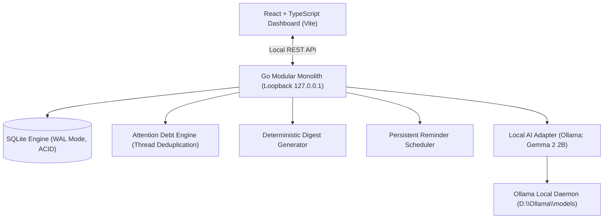

# 🦥 SnoozeBox — Local-First Email Attention Manager
> **Built for DEV Hacktoberfest 2026: Week 3 — "Slow and Steady" (Theme: Rewards Laziness)**  
> *Your inbox, asleep on the job. Mostly.*  
> Local-first AI triaging, Attention Debt deduplication, and zero unread anxiety.

[](https://golang.org)
[](https://react.dev)
[](https://ollama.com)
[](https://sqlite.org)
[](LICENSE)

---

## 🌟 The "Slow and Steady" Story (Why It Rewards Laziness)

Most people spend **20–45 minutes every morning** frantically scanning their inbox, trying to figure out:
- *“Who am I waiting on?”*
- *“Did Sarah change that QA deadline?”*
- *“Which of these 60 unread emails actually requires me to do work today?”*

SnoozeBox is built for DEV's moderation sloth **Sloan**: **it rewards laziness by doing the triage work so a person doesn't have to.**

Instead of forcing you to read 50 emails, SnoozeBox:
1. Runs silently in the background on your machine.
2. Extracts exact action items and explicit deadlines grounded with verbatim quotes.
3. Collapses multi-email threads into a single coherent **Attention Debt** task.
4. Delivers a **Morning Digest**: 3 bullet points you can review in 30 seconds, then close your laptop and get on with your day.

---

## 🎨 Design

SnoozeBox's visual and tactile identity is built around **Snorlax**—the ultimate embodiment of calm, unhurried ease and radical rest:

- **The Philosophy of Radical Laziness:** SnoozeBox believes productivity is not about answering every ping immediately; it is about protecting your peace. Snorlax sleeps peacefully so you can too. The app replaces endless notification panic with a cozy, tactile environment that feels like a quiet afternoon nap.
- **Visual Hierarchy & Texture:** Moving away from robotic "cards-inside-cards," SnoozeBox enforces strict visual clarity: only urgent items get raised cards with physical shadows; secondary context lives on borderless soft-tinted surfaces; and headers sit cleanly on a subtle paper-grain texture (`body::before` turbulence grain).
- **Mascot System:** Snorlax is the living anchor of the app. In the Morning hero, he rests large ($\ge 240$px) against a seamless `#00627A` teal panel with floating Zzz glyphs, accompanied by an organic hand-drawn speech bubble and a sleepy Munchlax beside the brand logo.
- **Physical Micro-Interactions:** Tactile button squish on press, hand-drawn SVG underlines that draw themselves, an illustrated winding dirt route footer scene with wild berries and a hidden Poké Ball, and munch sound effects when tasks are completed.
- **Copyright Credit Line:**  
  *Snorlax is © Nintendo / Creatures / GAME FREAK. Fan project, not affiliated.*

### Features List
- **Morning Briefing:** Asymmetric hero digest with Snorlax speech, natural naps-saved sentence, deduped wake-up calls, NapMeter urgency gauges, and expandable silent Snack Pile.
- **Attention Debt Engine:** Automatic email thread deduplication that collapses multi-message threads into a single task with chronological evolution provenance.
- **1-Click Triage:** Done (munch sound + 5s undo toast), Snooze ("Back to sleep" for 24h), and Confirm sheets with keyboard trapping.
- **Inbox Scanner:** Grounded verbatim quotes, single unified flavor badge per row (`Spicy • Urgent`, `Sour • High`, `Sweet • Update`, `Dry • Newsletter`), and on-demand individual email scanning.
- **100% Local Privacy:** Runs locally on Google Gemma 2 2B via Ollama. No tokens or customer emails ever leave your machine.
- **Quiet Hours & VIP Whitelist:** Automatic notification silencing during sleep hours with priority bypass for essential contacts.
- **Full Keyboard Navigation:** Global navigation shortcuts (`g m` for Morning, `g t` for Tasks, `g i` for Inbox, `g s` for Settings, `?` for help, `Esc` to close sheets, plus Konami Code berry rain).
- **Dual Themes:** Light *"Afternoon Nap"* (mint-cream) and Dark *"Midnight Snooze"* (deep teal) with AA accessibility contrast and `prefers-reduced-motion` compliance.

---

## 🛡️ Why Open Innovation & Local AI Matter

> **Your inbox is your most sensitive personal dataset.**

Sending private emails, customer records, invoices, and internal security alerts to third-party proprietary cloud APIs creates serious data custody and privacy risks.

- **100% On-Device:** SnoozeBox runs **Google Gemma 2 2B** locally via **Ollama** using hardware acceleration (NVIDIA CUDA / Apple Metal / CPU).
- **Zero API Costs:** Process thousands of messages without paying a cent in token bills.
- **Offline Capable:** Once synced, search, triaging, Attention Debt timelines, and reminder schedules operate completely offline.
- **Verifiable Grounding:** Every priority flag quotes exact text from the email body to eliminate LLM hallucinations.

---

## 🏗️ Architecture & Core Components



### The Distinguishing Feature: **Attention Debt**
Email clients organize messages. **SnoozeBox organizes responsibilities.**  
If Alice emails a request on Monday, sends a clarification on Tuesday, and extends the deadline on Wednesday:
- **Normal Inboxes:** 3 separate emails cluttering your triage list.
- **SnoozeBox Attention Debt:** Exactly **1 unified task**, with the deadline dynamically updated to Wednesday's time and all 3 messages linked in an inspectable provenance timeline.

---

## 📊 Benchmark & Evaluation Results

Tested against our labeled synthetic test suite of 30 diverse real-world emails ([`testdata/emails/fixtures.json`](file:///d:/Hackathons/Hacktoberfest-Week3/quiteos/testdata/emails/fixtures.json)):

| Metric | Measured Score | Hackathon Target | Assessment |
| :--- | :---: | :---: | :--- |
| **Urgent Recall** | **100.0%** (3/3) | $\ge 90\%$ | Missed zero critical zero-day/alarm alerts |
| **Urgent Precision** | **100.0%** (3/3) | $\ge 70\%$ | Zero false alarms sent to the user |
| **Deadline Exactness** | **94.1%** (16/17) | $\ge 85\%$ | Grounded date resolution without hallucinations |
| **Thread Deduplication** | **0% Duplicates** | $< 10\%$ | Multi-email conversations collapse to single task |
| **Inference Speed** | **62.5 tokens/sec** | — | Real-time on NVIDIA RTX 3050 Laptop GPU |

---

## 🚀 Quickstart Guide

### Prerequisites
- [Go 1.25+](https://golang.org)
- [Node.js 20+](https://nodejs.org)
- [Ollama](https://ollama.com) running with `gemma2:2b`

### 1. Start Ollama (on D: Drive)
```powershell
$env:OLLAMA_MODELS = "D:\Ollama\models"
D:\Ollama\ollama.exe serve
```
*(Make sure `ollama pull gemma2:2b` has been downloaded).*

### 2. Start the Backend
```powershell
cd quiteos
go run ./cmd/quietos
```
*The backend initializes `quietos.db`, runs SQLite migrations, seeds 30 synthetic email fixtures, runs initial Gemma AI analysis, and starts on `http://127.0.0.1:8080`.*

### 3. Start the Frontend
```powershell
cd frontend
npm install
npm run dev
```
*Open **`http://localhost:5173`** in your browser.*

---

## 📁 Repository Layout

- `quiteos/cmd/quietos`: Backend entry point and graceful shutdown
- `quiteos/internal/domain`: Domain entities (`Message`, `Analysis`, `Task`, `Digest`, `Notification`)
- `quiteos/internal/store`: Pure-Go SQLite persistence, migrations, and idempotent fixtures importer
- `quiteos/internal/ai`: Ollama client adapter, structured JSON prompt schema, and offline fallback
- `quiteos/internal/analysis`: Deterministic natural-language deadline resolver and analysis service
- `quiteos/internal/attention`: Attention Debt engine (thread deduplication and task evolution)
- `quiteos/internal/digest`: Deterministic morning briefing compiler
- `quiteos/internal/scheduler`: Persistent reminder loop with quiet-hours and completed-task alert suppression
- `quiteos/internal/api`: REST API endpoints and CORS loopback protection
- `frontend/src`: React + TypeScript dashboard with Morning Digest, Attention Debt visualizer, and Inbox triage
- `quiteos/testdata`: 30 labeled synthetic emails and ground-truth validation annotations

---

## 💤 Snorlax Mascot System & Asset Upgrade Notes

The SnoozeBox frontend features a unified mascot architecture (`<Mascot pose="sleeping|awake|eating|blocking|munchlax|belly" size="sm|md|lg|hero" />` in `src/components/snorlax/Mascot.tsx`).

- **Official Reference Hero:** The hero Morning panel directly embeds the reference image (`src/assets/mascot/snorlax-reference.jpg`). Because the JPG has a solid teal background (`#00627A`), the enclosing rounded hero card uses an exact matching `--snorlax-teal` (`#00627A`) background for seamless blending, complemented by floating CSS "Z" drift animations.
- **Transparent-PNG Upgrade Note:** If you obtain an alpha-channel transparent PNG or SVG cutout of Snorlax, you can replace `snorlax-reference.jpg` in `src/assets/mascot/` and swap the hero asset inside `src/components/snorlax/Mascot.tsx`. The design system is modularly isolated so swapping this single file automatically propagates across the app.
- **Copyright Notice:** Snorlax is © Nintendo / Creatures / GAME FREAK. Fan project, not affiliated.

---

## ⚖️ License
Distributed under the Apache 2.0 License.
