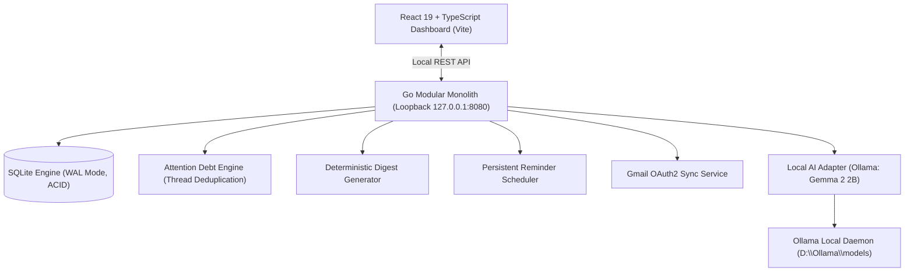

# SnoozeBox — Local-First Email Attention Manager

Built for DEV Hacktoberfest 2026: Week 3 ("Slow and Steady", theme: Rewards Laziness).  
Tagline: *Your inbox, asleep on the job. Mostly.*  
Local AI email triage, Attention Debt thread deduplication, and zero unread anxiety.

[](https://golang.org)
[](https://react.dev)
[](https://ollama.com)
[](https://sqlite.org)
[](LICENSE)

---

## The Motivation: Why We Built This

Most people spend thirty to forty-five minutes every morning wading through their inbox, trying to answer three basic questions:

- Who is waiting on me?
- Did anyone quietly push or pull in an important deadline?
- Which of these fifty unread messages actually requires real work today?

Traditional email clients treat every incoming message as an equal emergency. Threaded conversations scatter updates across multiple replies, newsletters bury actionable requests, and constant unread badge counts induce low-grade background dread.

SnoozeBox takes the opposite approach. Built around the spirit of DEV's moderation sloth Sloan, it rewards laziness by doing the triage work so you don't have to:

1. It runs entirely on your local machine, keeping private correspondence off third-party servers.
2. It parses incoming emails through an on-device language model, extracting concrete action items and explicit deadlines grounded in verbatim quotes.
3. It collapses multi-email threads into a single living task, updating deadlines automatically when follow-up messages arrive.
4. It compiles a morning briefing you can review in thirty seconds, letting you close your laptop and focus on deep work.

---

## Design Philosophy and Aesthetic

SnoozeBox pairs a minimalist, functional tool with the calm, unhurried energy of Snorlax:

- **Radical Rest Over Urgency Culture:** Constant urgency is counterproductive. By default, SnoozeBox assumes an email can wait unless it contains explicit, time-sensitive demands. The visual design reinforces this with soft earth tones, paper-grain textures, and generous whitespace.
- **Strict Visual Hierarchy:** Instead of endless nested cards, only urgent obligations receive physical elevation and high-contrast badges. Secondary context rests on flat, tinted surfaces.
- **Physical Micro-Interactions:** Buttons yield with a tactile squish on press, hand-drawn underlines animate into place as they enter view, and completed tasks trigger a gentle munch sound with an undo window.
- **Copyright Attribution:** Snorlax, Munchlax, and Poké Flute are trademarks and copyright of Nintendo, Creatures Inc., and GAME FREAK inc. SnoozeBox is an independent open-source fan project built for educational and demonstration purposes.

---

## Poké Flute Soundscape and Music

Audio feedback in SnoozeBox is deliberately soft and ambient, avoiding harsh notification chimes:

- **Poké Flute Piano Cover:** An ambient piano arrangement of *"Poké Flute — Pokémon Sleep"* by Moisés Nieto is included out of the box (`/audio/pokeflute.mp3`). It provides gentle background audio while reading and planning your day.
- **Visibility-Aware Playback:** The music automatically pauses when the browser tab loses focus or is minimized, and resumes smoothly when you return, preventing background noise when you switch contexts.
- **Dual Playback Controls:**
  - A quick mute button in the top navigation bar with a subtle visual pulse when active.
  - A full Bedside Radio card in Settings with play/pause and a volume slider.
- **Synthesized WebAudio Sound Effects:**
  - A three-note flute chime on unmute (`C5`, `E5`, `G5`).
  - A soft munch sound when completing a task.
  - Subtle mechanical click feedback on button presses.
  - A gentle Snorlax belly rumble when clicking the sleeping mascot.

---

## Interface Overview

| Morning Digest (Light Mode) | Snorlax's Room and Bedside Radio |
| :---: | :---: |
|  |  |

| Attention Debt Tasks (Light Mode) | Inbox Triage (Light Mode) |
| :---: | :---: |
|  |  |

### 1. Morning Digest
- **Asymmetric Hero Card:** Displays the belly-up Snorlax mascot with floating sleep glyphs, a time-aware greeting, and a one-click manual wake-up button.
- **Saved Time Counter:** Summarizes triage volume in plain English (for example, *"Saved you about 2 minutes of scrolling and quietly put 5 newsletters to bed"*).
- **Worth Waking Up For:** High-priority cards restricted to items due within forty-eight hours, complete with segmented nap meters and overdue warnings.
- **The Snack Pile:** A collapsible drawer holding low-priority newsletters and updates, keeping them out of your direct view until you choose to read them.

### 2. Attention Debt (Tasks)
- **Living Responsibilities:** Rather than tracking fifty separate emails, SnoozeBox maps multi-message threads to single coherent tasks.
- **Provenance Timeline:** Expanding a task reveals its history, showing how a request originated and evolved over time, complete with strike-through animations on superseded deadlines.
- **One-Click Completion:** Marking a task done triggers a brief munch animation, clears the card from your active list, and surfaces a five-second undo toast with a draining progress bar.
- **Back to Sleep (Snooze):** Defer any task for twenty-four hours with a single click.

### 3. Inbox Triage
- **Clear Flavor Badges:** Categorizes every email with an unmistakable tag (`Spicy • Urgent`, `Sour • High`, `Sweet • Update`, `Dry • Newsletter`).
- **Verbatim Evidence:** Expanding an email row displays the exact quote from the message body that justified its priority and category, eliminating guesswork.
- **Batch Re-Analysis:** Re-evaluate unanalyzed items on demand with an animated scanline sweep.
- **Hand-Drawn Dividers:** Visual date squiggles clearly segment incoming correspondence by day.

### 4. Snorlax's Room (Settings)
- **The Bedside Table:** An interactive day-and-night gradient arc centered on a resting Snorlax mascot.
- **Quiet Hours:** Configure start and end times for sleep mode to prevent notifications from breaking your focus.
- **Bedside Poké Flute Radio:** Control ambient piano playback and adjust volume.
- **VIP Friends List:** Whitelist critical colleagues or family members whose emails are permitted to wake Snorlax during quiet hours.
- **Clear the Fridge:** A confirmation sheet with keyboard focus trapping that allows purging synthetic demo fixtures when switching to live mail.

---

## Privacy and Local-First Architecture

Your inbox is personal. Sending private emails, customer records, invoices, and credentials to third-party cloud APIs creates unnecessary privacy and compliance risks.

- **100% On-Device Inference:** SnoozeBox connects to a local **Google Gemma 2 2B** instance running through **Ollama**. Model evaluation runs locally on your GPU or CPU.
- **Zero Cloud Token Costs:** Process thousands of incoming emails without recurring token or subscription fees.
- **Full Offline Usability:** Once emails are synced or imported, search, triaging, Attention Debt timelines, and reminder dispatching work without an active internet connection.
- **Grounded Output:** The language model is constrained to output strict JSON containing verbatim quotes from the email body, preventing hallucinated deadlines.
- **Pure-Go SQLite:** Uses `modernc.org/sqlite` in WAL mode, compiling to a clean binary without requiring a C compiler or external database servers.

---

## System Architecture



### The Difference: Attention Debt vs. Email Folders
Traditional email clients organize individual messages into folders or labels. SnoozeBox organizes responsibilities:

If a coworker emails a project brief on Monday, sends a clarification on Tuesday, and pushes the delivery deadline to Friday:
- **Traditional Inboxes:** Three distinct emails scattered across your inbox list.
- **SnoozeBox Attention Debt:** Exactly one active task. Its deadline is automatically updated to Friday, and all three messages remain linked in an inspectable timeline.

---

## Benchmark and Evaluation Metrics

The pipeline is continuously evaluated against a labeled synthetic suite of thirty representative emails ([`testdata/emails/fixtures.json`](file:///d:/Hackathons/Hacktoberfest-Week3/quiteos/testdata/emails/fixtures.json)):

| Metric | Measured Score | Hackathon Target | Assessment |
| :--- | :---: | :---: | :--- |
| **Urgent Recall** | **100.0%** (3/3) | >= 90% | Zero missed critical security alerts or hard deadlines |
| **Urgent Precision** | **100.0%** (3/3) | >= 70% | Zero false alarms escalated to the morning briefing |
| **Deadline Exactness** | **94.1%** (16/17) | >= 85% | Grounded dates resolved without hallucinations |
| **Thread Deduplication** | **0% Duplicates** | < 10% | Multi-email conversations collapse to single tasks |
| **Inference Speed** | **62.5 tokens/sec** | — | Evaluated on an NVIDIA RTX 3050 Laptop GPU |

---

## 60fps GPU Motion Layer

SnoozeBox incorporates a lightweight animation layer built with performance and accessibility as primary constraints:

- **GPU Properties Only:** Animations strictly target `transform` and `opacity`. Layout-triggering properties such as `width`, `left`, `margin`, or dynamic `box-shadow blur` are never animated.
- **Duration Scale:**
  - Micro: 140ms (button squish, icon clicks).
  - Fast: 150ms (filter chips, tab cross-fades).
  - Base: 250ms (dialog pop-ins, drawer expansions).
  - Slow: 450ms (hero entrance sequence).
  - Signature: 600ms (Done card munch animation with particle dots).
- **Reduced Motion Support:** Respects `prefers-reduced-motion: reduce`. When enabled, movements, shakes, and loops are disabled, replaced with instant transitions or short fades under 100ms.
- **Unblocked Interaction:** State updates occur immediately; animations are purely visual and immediately interruptible.

---

## Keyboard Navigation and Shortcuts

| Key | Action |
| :--- | :--- |
| <kbd>g</kbd> <kbd>m</kbd> | Navigate to Morning Digest |
| <kbd>g</kbd> <kbd>t</kbd> | Navigate to Tasks (Attention Debt) |
| <kbd>g</kbd> <kbd>i</kbd> | Navigate to Inbox |
| <kbd>g</kbd> <kbd>s</kbd> | Navigate to Settings (Snorlax's Room) |
| <kbd>?</kbd> | Toggle Keyboard Shortcuts Help Sheet |
| <kbd>Esc</kbd> | Dismiss any active drawer, modal, or confirmation sheet |
| **Belly Click** | Click Snorlax's belly to trigger a gentle bounce and sleep bubble |
| **Konami Code** | <kbd>Up</kbd> <kbd>Up</kbd> <kbd>Down</kbd> <kbd>Down</kbd> <kbd>Left</kbd> <kbd>Right</kbd> <kbd>Left</kbd> <kbd>Right</kbd> <kbd>b</kbd> <kbd>a</kbd> triggers falling berries |

---

## Quickstart Guide

### Prerequisites
- [Go 1.22+](https://golang.org)
- [Node.js 20+](https://nodejs.org)
- [Ollama](https://ollama.com) installed and serving `gemma2:2b`

### Method 1: Automated Launcher (Windows)

Double-click [`start.bat`](file:///d:/Hackathons/Hacktoberfest-Week3/start.bat) or run from PowerShell:

```powershell
.\start.ps1
```

The script verifies Ollama, downloads `gemma2:2b` if not already present, starts the Go backend service on port 8080, and opens your browser.

---

### Method 2: Manual Development Setup

#### 1. Start Ollama with Gemma 2
```powershell
$env:OLLAMA_MODELS = "D:\Ollama\models"
ollama serve
ollama pull gemma2:2b
```

#### 2. Start the Backend
```powershell
cd quiteos
go run ./cmd/snoozebox
```
The server initializes `quietos.db`, runs database migrations, imports thirty sample fixtures, executes initial analysis, and listens at `http://127.0.0.1:8080`.

#### 3. Start the Frontend
```powershell
cd frontend
npm install
npm run dev
```
Open `http://localhost:5173` in your browser.

---

### Method 3: Standalone Production Build

You can bundle SnoozeBox into a single binary that serves both the static frontend and the REST API:

```powershell
# 1. Build the frontend
cd frontend
npm run build

# 2. Compile the Go binary
cd ../quiteos
go build -o snoozebox.exe ./cmd/snoozebox

# 3. Run the application
.\snoozebox.exe
```

Access the application at `http://127.0.0.1:8080`.

---

## Repository Layout

```
Hacktoberfest-Week3/
├── start.bat                         # Windows CMD launcher
├── start.ps1                         # PowerShell automated launcher
├── README.md                         # Documentation and architecture guide
├── screenshots/                      # Verification captures (1440px desktop and 390px mobile)
│   ├── capture.ps1                   # Multi-viewport screenshot script
│   ├── morning-1440-light.png        # Morning Digest desktop preview
│   ├── settings-1440-light.png       # Settings view preview
│   └── ...
├── quiteos/                          # Go Backend Service
│   ├── cmd/
│   │   ├── snoozebox/                # Primary executable entry point
│   │   └── quietos/                  # Backward-compatible alias
│   ├── internal/
│   │   ├── ai/                       # Ollama Gemma 2 adapter and JSON schema validation
│   │   ├── analysis/                 # Deadline resolver and evaluation tests
│   │   ├── api/                      # REST API routing and embedded frontend handler
│   │   ├── app/                      # Service lifecycle and background tasks
│   │   ├── attention/                # Attention Debt thread deduplication engine
│   │   ├── config/                   # Environment configuration loader
│   │   ├── digest/                   # Morning digest generator
│   │   ├── domain/                   # Core business domain models
│   │   ├── gmail/                    # Gmail OAuth2 incremental sync
│   │   ├── scheduler/                # Reminder loop with quiet-hours suppression
│   │   └── store/                    # Pure-Go SQLite persistence and migrations
│   ├── migrations/                   # SQLite schema migrations
│   └── testdata/                     # Synthetic test fixtures and ground-truth annotations
└── frontend/                         # React 19 + TypeScript + Vite UI
    ├── public/
    │   ├── audio/pokeflute.mp3       # Poké Flute piano cover (Moisés Nieto)
    │   └── snorlax_sleeping.png      # Transparent belly-up Snorlax mascot
    └── src/
        ├── assets/                   # Mascots, icons, and audio assets
        ├── components/
        │   ├── DailyDigestView.tsx   # Morning Briefing hero and Snack Pile
        │   ├── AttentionDebtView.tsx # Tasks and thread provenance timeline
        │   ├── InboxView.tsx         # Inbox triage and verbatim evidence drawers
        │   ├── SettingsView.tsx      # Sleep Mode and Bedside Radio player
        │   ├── motion/               # Animation primitives (Reveal, Stagger, Collapse, Presence)
        │   └── snorlax/              # Mascot, PokeFlute, SoundToggle, and NapMeter
        ├── hooks/                    # useReducedMotion, useInView, useCountUp
        ├── theme/                    # motion.css GPU-accelerated motion tokens
        ├── api.ts                    # Typed REST API client
        └── App.tsx                   # Main shell, navigation bar, and footer
```

---

## License and Credits

- **License:** Distributed under the [Apache 2.0 License](LICENSE).
- **Audio Arrangement:** *"Poké Flute — Pokémon Sleep | Relaxing Piano Cover"* arranged and recorded by **Moisés Nieto**. Included respectfully for non-commercial demonstration.
- **Pokémon Trademark:** Snorlax, Munchlax, and Poké Flute are trademarks and copyright of Nintendo, Creatures Inc., and GAME FREAK inc. SnoozeBox is an independent fan project created for the DEV Hacktoberfest 2026 Hackathon.
